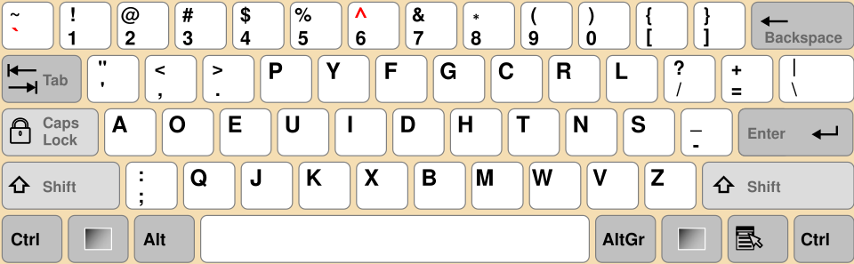

# Dr. Dvorak's Document (1)

## Zadání

Hi Associate Researcher,

The National Research and Education Network (NREN) has many experts, such as is Dr. Simon Dvorak, Chair of the Committee for Strategic QWERTY Decommissioning, member of 17 working groups, editor of 42 draft documents, and self-proclaimed "Home Row Evangelist".

Yesterday, Dr. Dvorak briefly visited a shared workstation in the NREN office. Without looking at the keyboard, he quickly typed an important document, saved it, and left for following National QWERTY Transition Initiative meeting.

Unfortunately, the resulting document appears to be complete nonsense. Your task is to recover the correct document.

Stay curious!

Download the [typed document](dr_dvoraks_document.txt).

## Nápovědy (Hints)

1. The workstation was configured with the standard QWERTY layout.
2. Mr. Dvorak produced the document at an astonishing speed while several of Dvorak enthusiasts chanted in support "One layout! One home row! Dvorak Simplified!".

## Řešení

Soubor ze zadání obsahuje text napsaný uživatelem zvyklým na rozložení klávesnice Dvorak, které je jiné, než QWERTY.



Je tedy potřeba přemapovat text.

```text
Dear colleagues, supporters, and those who are still using QWERTY,

It is a great honor to become the new Coordinator of the National QWERTY Transition Initiative.

For over a century, humanity has endured unnecessary finger travel, awkward key placement, and the mysterious existence of the letter "Q." The initiative is dedicated to correcting these historical mistakes through research, education, and responsible keyboard reform.

This year we will continue our work in home-row optimization, keystroke minimization, and the rehabilitation of long-term QWERTY users. We remain committed to our mission: reducing finger movement while increasing human potential.

To our new supporters, I say: the journey will be challenging. Friends may question your choices. Family members may refuse to switch layouts. Stay strong, think about FLAG{BCjM-6SpO-HVpI-N13B}. Every great change begins with a remapping file.

Thank you, and please collect your mandatory Dvorak transition manuals on your way out.
```

## Flag

`FLAG{BCjM-6SpO-HVpI-N13B}`
