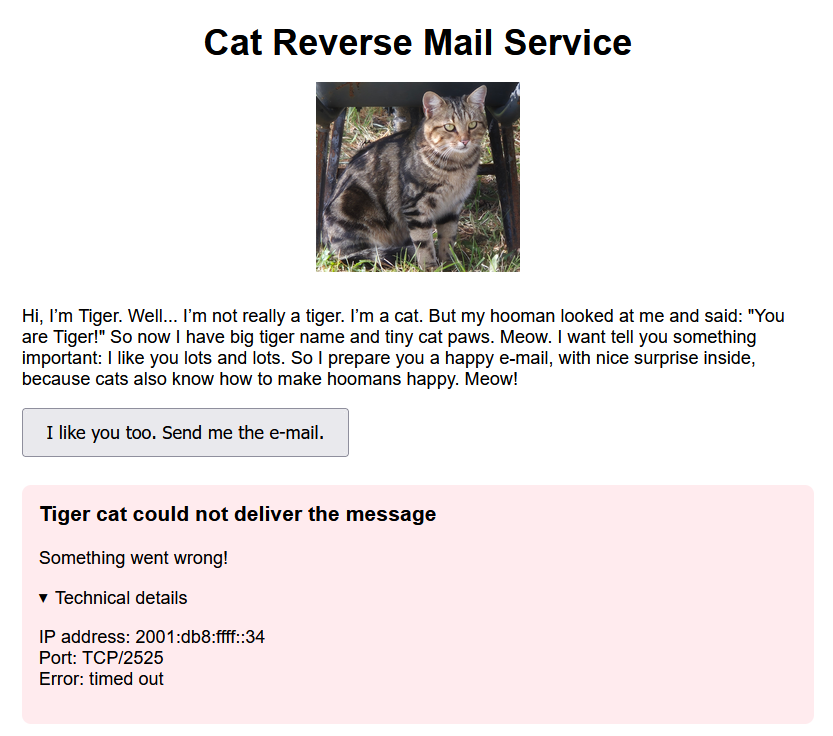

# CRMS (1)

## Zadání

Hi Associate Researcher,

cats are valued members of the NREN-TCC community. Their curiosity, intelligence, and dedication help advance science, research, and education. Always eager to assist, these furry colleagues work tirelessly to support everyone—one paw, one discovery, and one helpful message at a time.

"Need help? Just ask the NREN cat team. For example, they have recently created a new service called CRMS", says the Head of the Department of Feline Research.

Stay curious!

Access the service at <http://crms.nren.tcc/>

## Nápovědy (Hints)

1. All services in `nren.tcc` domain are accessible via VPN only.
2. Specialists from the Department of Feline Research have discovered that experimental message reception does not require complex infrastructure. A small test mail server is just as effective for the task.

## Řešení

Po otevření stránky a stisknutí tlačítka se zobrazí chybová hláška



Z ní je vidět, že se stránka pokouší připojit na mojí IPv6 VPN adresu, port TCP/2525 a odeslat mail.

Spustíme jednoduchý SMTP server, který bude posílat správné odpovědi

```python
import socket, sys
s = socket.create_server(("", 2525), family=socket.AF_INET6, dualstack_ipv6=True, reuse_port=False)
print("Ready")
while True:
    c, a = s.accept()
    f = c.makefile("rb")
    c.send(b"220 ctf ESMTP\r\n")
    data = False
    for l in f:
        if data:
            if l.rstrip(b"\r\n") == b".":
                data = False
                c.send(b"250 OK\r\n")
                continue
            print(l.decode(errors="replace"), end="", flush=True)
        elif l[:4].upper() == b"DATA":
            data = True
            c.send(b"354 End with .\r\n")
        elif l[:4].upper() == b"QUIT":
            c.send(b"221 Bye\r\n")
            break
        else:
            c.send(b"250 OK\r\n")
    c.close()
```

Server vypíše email, který úloha pošle

```text
Subject: Message from Tiger (not a tiger)
From: Tiger the Cat <tigercat@dfr.nren.tcc>
To: my favorite player

Hello hooman,

I'm sending you a secret code, to make you happy.

FLAG{eEA9-WUne-CloQ-Ofaz}

Do not share it with dogs!

Tiger the Cat
Hooman communication specialist
Department of Feline Research
NREN-TCC
```

## Flag

`FLAG{eEA9-WUne-CloQ-Ofaz}`
