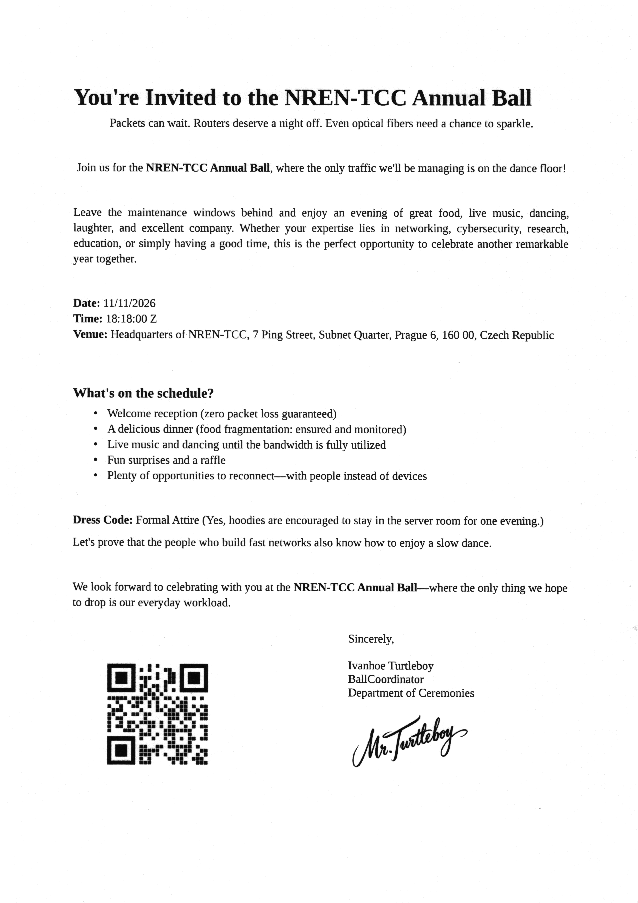

# Document Scan (2)

## Zadání

Hi Senior Researcher,

an awkward incident occurred at the NREN headquarters: an important  document was scanned and immediately shredded for security reasons. However, the digital copy has since disappeared, and no trace can be found on the file servers.

Fortunately, a network capture of the scanner’s communication was recorded at the time of the incident. Your task is to reconstruct the missing document from the PCAP.

Stay curious!

Download the [evidence](document_scan.zip).

## Nápovědy (Hints)

1. The evidence also contains a scan of a reference document and a related PCAP, which was acquired immediately after the incident was reported (we hope the scanner settings were the same).

## Řešení

Stažený soubor obsahuje záznam komunikace scanneru na TCP portech 8610 <--> 53769 a referenční obrázek o rozměru 4960x7015.

Vytáhneme si přenesená data. Číslo 13 je číslo TCP streamu, který se dá zjistit po otevření záznamu ve Wiresharku

`tshark -r document_scan.pcapng -q -z follow,tcp,raw,13 > document.hex`

Záznam obsahuje pro každý pixel hodnotu 0..255, která reprezentuje odstíny šedi. Jednoduchým programem převedeme data na obrázek

```python
from PIL import Image

data = open("document.hex").read().split("\n")

x = 4960
y = 7015
img = Image.new('L', (x, y), color=255)
pixels = img.load()

raw_bytes = b''
i = 0
while i < len(data):
    line = data[i]
    if len(line) > 200:
        raw_data = line[49:]
        i += 1
        while data[i][0] == "\t":
            raw_data += data[i][1:]
            i += 1
    else:
        raw_data = ""
        i += 1

    if raw_data != "":
        raw_bytes += bytes.fromhex(raw_data)
        raw_data = ""

for i in range(len(raw_bytes)):
    if i < x*y:
        pixels[i % x, i // x] = raw_bytes[i]

img.save('document.png')
```

Výsledný obrázek je 

QR kód obsahuje flag.

## Flag

`FLAG{GOTO-NREN-BALL-BABY}`
