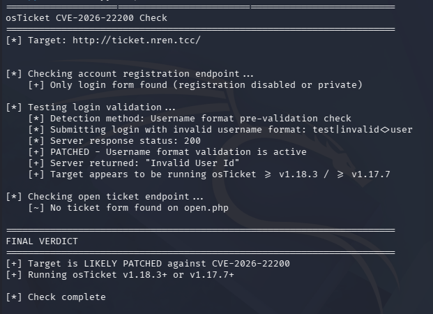

# Ticket System (3)

## Zadání

Hi Senior Researcher,

we suspect that some of the systems used in our daily operations are allowing sensitive information to leak to competing research organizations. Your task is to determine whether the help desk's ticket management system is secure and no data are in danger.

Stay curious!

Ticket System is available on <http://ticket.nren.tcc>.

## Nápovědy (Hints)

1. If guessing does not work, cleaning cache or new browser session might help.

## Řešení

WEB stránka ze zadání obsahuje ticketovací systém osTicket.

V poslední době se v osTicket vyskytla chyba CVE-2026-22200, ale vypadá to, že tohle není cesta.



Z Knowledgebase jsem získal informaci, že se tam pravděpodobně vyskytují uživatelé `Dmitri` a `Eve` a také že pro kontrolu ticketů se má použít email ve formátu `name@nren.tcc` a číslo ticketu je 1..10.

To není moc kombinací, takže se dá snadno odhalit, že pro kombinaci `dmitri@nren.tcc a 3` se vypíše ticket s přístupovými informacemi pro databázi.

```text
database server: db.nren.tcc
database: crmtest
user: crmtest
pass: LearnHowToOptimize
```

Můžeme použít Adminer z úlohy Experimental server na adrese <http://x-www26-2.nren.tcc/adminer.php> pomocí kterého snadno přečteme flag z tabulky `secrets`.

## Flag

`FLAG{BZPL-lZ0x-JkZH-gVoD}`
